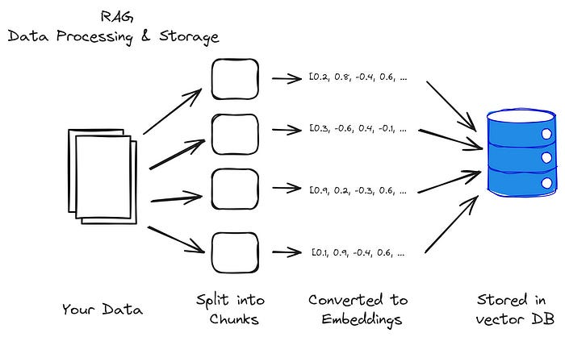
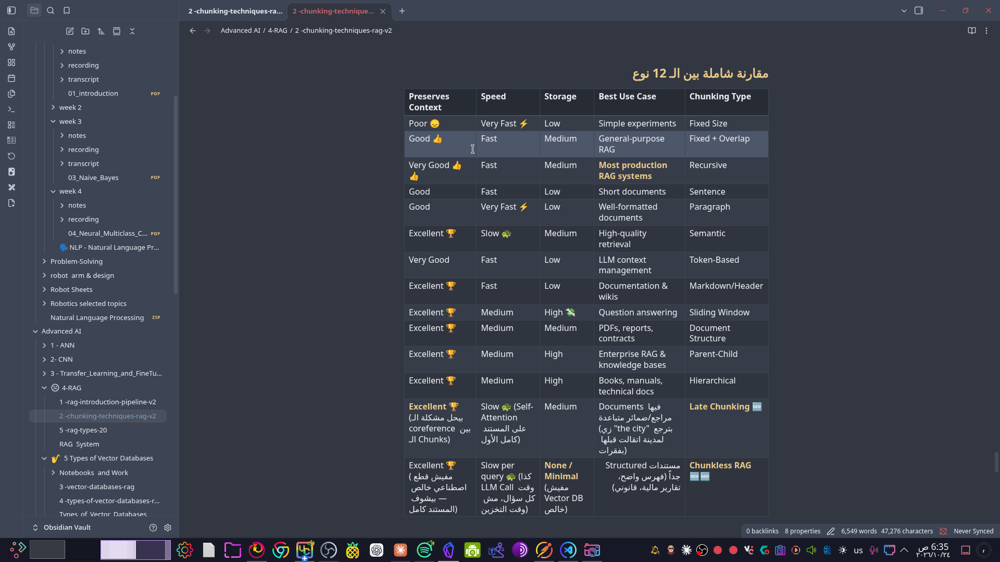

# mini-rag — Course Notes
> Notes I take while following the course, plus things I searched/learned on my own.

## 🗺️ Video ↔ Branch map
| Video | Branch | Topic |
|-------|--------|-------|
| 04 | `tut/001` | Project Boilerplate |
| 05 | `tut/002` | Requirements & First FastAPI App |
| 06 | `tut/003` | Nested Routes + Env Values |
| 07 | `tut/004` | Project Structure + File Upload |
| 08 | `tut/005` | File Processing (schema + loaders + chunking) |

> 💬 أي سطر بيبدأ بـ 💬 ده كومنت للفهم، مش من كلام الكورس.

---

## 🎬 mini-RAG | 04 | Project Boilerplate · `tut/001`

### Git workflow
- One branch per tutorial: `tut/001`, `tut/002`, ...
- Branch naming matters. Teams use prefixes like `feature/...` or `fix/...`, or the Jira task ID.
- Commit after every small change. It becomes a habit.
- Finish the tutorial → merge into `main` → push.

### Essential files
| File | Purpose |
|------|---------|
| `.gitignore` | Files git should NOT track (cache, data, `.env`, `.venv`). Template from github/gitignore → Python |
| `LICENSE` | Project license (Apache 2.0) |
| `README.md` | The project's front door. Explain EVERYTHING as if the reader doesn't know Python |
| `.env` | Config + secrets (API keys). **Never commit it** |
| `.env.example` | Copy of `.env` with fake values. This is what gets committed |
| `assets/.gitkeep` | Keeps an empty folder tracked by git (opposite of `.gitignore`) |

### Config rules
- Env variable names are UPPER_SNAKE_CASE constants: `APP_NAME`, `OPENAI_API_KEY`.
- Values are strings or numbers.
- Every time you add a variable to `.env`, add it to `.env.example` too.
- A new developer runs `cp .env.example .env` and fills in their own values.

### Tip
- Always leave an empty line at the end of a file. Otherwise git shows a fake diff on the previous line.

---

## 🎬 mini-RAG | 05 | Requirements & First FastAPI App · `tut/002`

### FastAPI vs Uvicorn
- **FastAPI**: the web framework (routes, validation, docs). It pushes you to write standard code.
- **Uvicorn**: the ASGI **server** that actually runs the app and listens on a port.
- In production, uvicorn alone isn't enough. Put **Nginx** in front of it as a reverse proxy.
- **python-multipart**: needed for file uploads in FastAPI.

### Run the server
```bash
uvicorn main:app --reload --host 0.0.0.0 --port 5000
```
- `main:app` means the file `main.py` and the variable `app = FastAPI()`.
- `--reload` restarts the server automatically when the code changes. Use it in dev only.
- `--host 0.0.0.0` makes the server reachable from other devices on the network.
- `--port 5000` changes the port (the default is 8000).
- `python main.py` does NOT start the server. Use uvicorn.
- Stop with **Ctrl+C**. Ctrl+Z only pauses it, so the port stays busy (`Address already in use`). Fix: `kill %1`.

### URLs
- `/welcome` is my endpoint.
- `/docs` is Swagger UI, auto-generated. You can test every endpoint from here.
- `/redoc` is the same docs in another style.
- `404` on `/` is normal, because no route is defined for it.

### Pin versions! 📌
- Never put a package in requirements without a version. Otherwise the latest gets installed and may break the code.
- Get the version from pypi.org.

### uv (my upgrade) ⚡
Replaces pip + venv + conda + pip-tools. Written in Rust, so it's very fast.

| Task | Command |
|------|---------|
| Install everything (new `.venv`) | `uv sync` |
| Install into my conda env | `uv pip install -r requirements.txt` |
| Add a package | `uv add <pkg>` |
| Add a dev tool | `uv add --dev <pkg>` |
| Remove | `uv remove <pkg>` |
| Show outdated | `uv tree --outdated --depth 1` |
| Upgrade everything | `uv lock --upgrade` |
| Regenerate requirements | `uv export --no-hashes --no-dev --no-emit-project -o requirements.txt` |
| Run inside env | `uv run <cmd>` |

- `pyproject.toml` holds the package names. `uv.lock` holds the exact pinned versions. Commit both.
- Don't use `uv sync` with conda. It deletes packages that aren't in the lock.

---

## 🔍 Things I searched on my own

### Postman vs FastAPI `/docs`
- `/docs` is quick for testing the endpoints of a single app.
- **Postman** is a full API client. It saves requests, environments, and auth.
- **Postman Collection** is a group of saved requests. Export it as JSON or share a link, and a teammate can run the same tests.
- Alternatives: **Bruno** (open-source, stores requests as files inside the repo), Insomnia, and the **Thunder Client / REST Client** extensions in VS Code.

---

## 💡 Ideas to apply in my graduation project (legal RAG)
- Same structure: `.env` + `.env.example`, `uv`, one branch per feature.
- Use `/docs` to demo the API to the supervisor.

---

## 🎬 mini-RAG | 06 | Nested Routes + Env Values · `tut/003`

### Why split routes out of `main.py`?
- Putting every endpoint in `main.py` turns it into one huge file that's hard to maintain.
- Split by responsibility: every group of endpoints lives in its own file inside `routes/`.
- `main.py` only creates the app and **includes** the routers.

### Make `routes/` a Python package
- Add an empty `routes/__init__.py`, so Python treats the folder as a package you can import from.

```
routes/
├── __init__.py
└── base.py      ← base_router (welcome endpoint)
```

### `APIRouter`: a mini app for a group of endpoints
```python
from fastapi import APIRouter

base_router = APIRouter(
    prefix="/api/v1",   # added before every route in this router
    tags=["api_v1"],    # group name in /docs (Swagger)
)

@base_router.get("/")   # final path = /api/v1/
def welcome():
    ...
```
And in `main.py`:
```python
from routes import base
app.include_router(base.base_router)
```

| Param | What it does |
|-------|--------------|
| `prefix` | Default path before all routes in the router. `"/"` becomes `/api/v1/`. **Must start with `/`**, otherwise `AssertionError: A path prefix must start with '/'` |
| `tags` | Groups endpoints in `/docs`. Easy to rename later in one place |

- **Why `/api/v1`?** That's **API versioning**. If the API changes in a breaking way, add `/api/v2` and old clients keep working on v1.
- Both import styles work: `from routes import base` (the instructor's, nicer with many routers) or `from routes.base import base_router` (mine, more direct).

### Read values from `.env` instead of hardcoding
- Goal: the welcome response shows the app name, version and author from `.env`, not a hardcoded string.
```python
# main.py — load .env BEFORE importing routes
from dotenv import load_dotenv
load_dotenv(".env")

from routes import base
```
```python
# routes/base.py
import os
app_name = os.getenv("APP_NAME")
```
- `load_dotenv()` copies the `.env` values into the environment variables, then `os.getenv()` reads them.
- **Order matters:** call `load_dotenv` before importing any module that reads env values.
- New variable in `.env` (`AUTHOR`) → also add it to `.env.example` ✅
- ⚠️ `os.getenv` returns `None` if the variable is missing, with no error. Next step: `pydantic-settings` validates config at startup.

- ✅ Tested in Postman: the response now returns the app name, author and version from `.env`.

### `async def` — FastAPI handles many requests at once
- A normal `def` endpoint blocks a worker until it finishes. `async def` lets the server handle other requests **while waiting** (DB query, LLM API call, file upload).
- Rule: use `async def` + `await` when the endpoint calls async I/O (e.g. `httpx`, async DB drivers, OpenAI async client).
- ⚠️ Don't call blocking code (e.g. `time.sleep`, `requests.get`) inside `async def`, because it freezes the whole server. Use plain `def` for that, and FastAPI runs it in a thread pool.
```python
@base_router.get("/")
async def welcome():
    ...
```

### Postman
- **Postman** is an API client: send requests, see responses, save them.
- I opened the repo in Postman **Git mode (Local View)**, so everything is saved as YAML inside the repo:
```
.postman/resources.yaml                               ← workspace ID
postman/environments/local.environment.yaml           ← environment
postman/collections/mini-rag-app/welcome.request.yaml ← requests
```
- **Environment** `local`: variable `api = http://localhost:5000`, used as `{{api}}/api/v1/`.
  - The value is stored **locally only** (not in the YAML), so secrets never go to GitHub. After cloning, set `api` yourself.
- **Collection** `mini-rag-app`: groups all the project's requests.
- Request type **HTTP** (REST), method **GET**.

### 🐛 Bugs I hit
| Error | Cause | Fix |
|-------|-------|-----|
| `{{api}}` red + `ENOTFOUND` | Variable saved as `'   api'` (spaces) + empty value | Retype the name with no spaces, set the value, Ctrl+S |
| `404 Not Found` on `/api/v1/` | Router had no `prefix` yet | Add `prefix="/api/v1"` |
| `AssertionError: A path prefix must start with '/'` | Left `prefix="___"` | Prefix must start with `/` |

### Request flow
```
Postman ─ GET {{api}}/api/v1/ ─▶ uvicorn :5000 ─▶ main.py (app)
        ─▶ base_router (/api/v1) ─▶ welcome() ─▶ 200 OK + JSON
```

---

## 🎬 mini-RAG | 07 | Project Structure + File Upload · `tut/004`

### Start from a boilerplate
- Don't reinvent the wheel. Search `"<framework> boilerplate github"` (e.g. `fastapi boilerplate github`) and follow a structure other people already tested in production.
- Repo root keeps only project-level files (`README.md`, `LICENSE`). **All application code goes inside `src/`.** As the project grows you always know what is the app and what isn't.

### MVC: keep logic out of the routes
- **M**odels: the data (DB, enums, schemas).
- **V**iews: what the user sees. We have none, because this is an API.
- **C**ontrollers: the logic.
- A route should only **receive the request and call the logic**, not contain it. Separate logic means you can test the logic and the route independently.

```
src/
├── main.py
├── routes/        ← endpoints only (base.py, data.py)
├── controllers/   ← logic (BaseController, DataController, ...)
├── models/        ← data + enums
└── helpers/       ← shared utilities with no single owner (config.py)
```

### Why `__init__.py`?
- It makes the folder a **Python package**, so you can import from it.
- It's also the **import gateway** for the package:
```python
# controllers/__init__.py
from .DataController import DataController
```
```python
# anywhere else
from controllers import DataController   # instead of controllers.DataController.DataController
```
- Bonus: whatever is exported in `__init__.py` is the package's "public" API. The rest is internal.

### Config with `pydantic-settings` (replaces `load_dotenv` + `os.getenv`)
- Pydantic = data **validation**. You declare the type of every value, and the app fails at startup if a value is missing or has the wrong type, instead of a silent `None` later.
```python
# helpers/config.py
from pydantic_settings import BaseSettings

class Settings(BaseSettings):
    APP_NAME: str
    APP_VERSION: str
    FILE_ALLOWED_TYPES: list[str]   # JSON list in .env
    FILE_MAX_SIZE_MB: int

    class Config:
        env_file = ".env"

def get_settings():
    return Settings()
```
- `main.py` no longer needs `load_dotenv`. Each part asks `get_settings()` for the config.
- Change how config loads → change it in **one place**.

### `Depends`: dependency injection
```python
from fastapi import Depends
from helpers.config import get_settings, Settings

@base_router.get("/")
async def welcome(app_settings: Settings = Depends(get_settings)):
    return {"app": app_settings.APP_NAME}
```
- The route **depends** on the settings. FastAPI calls `get_settings()` and passes the result in, so the route never runs without them.
- `: Settings` is a type hint. It doesn't change behavior, but the editor gets autocomplete and the reader knows it's a class (not a dict or a list).

### Upload endpoint + `project_id`
```python
data_router = APIRouter(prefix="/api/v1/data", tags=["api_v1", "data"])

@data_router.post("/upload/{project_id}")
async def upload_data(project_id: str, file: UploadFile,
                      app_settings: Settings = Depends(get_settings)):
    ...
```
- `{project_id}` is a **path parameter**. Every file belongs to a project, so the app is **multi-tenant** from day one (each project is separate).
- `project_id: str`, not `int`: it's an identifier, not a number you do math on.
- `UploadFile` needs `python-multipart` (already installed in tut 002).
- Remember: `app.include_router(data.data_router)` in `main.py`, otherwise `404`.

### Never trust an uploaded file: validate it
- Check the **type** and the **size** before writing anything to disk.
- Limits live in `.env` (+ `.env.example` + `Settings`), not hardcoded:
```env
FILE_ALLOWED_TYPES=["text/plain", "application/pdf"]
FILE_MAX_SIZE_MB=10
```
- Prefix related settings (`FILE_...`) so you know what belongs to what.
- Check the **MIME type** (`file.content_type`), not the extension. Anyone can rename `virus.exe` to `cv.pdf`. MIME isn't perfect protection, but it's much better.
- `file.size` is in **bytes**, the setting is in **MB**: compare against `FILE_MAX_SIZE_MB * 1024 * 1024`.

### `BaseController` + inheritance
- All controllers need the settings, so load them once in a parent class:
```python
# controllers/BaseController.py
class BaseController:
    def __init__(self):
        self.app_settings = get_settings()
```
```python
# controllers/DataController.py
from .BaseController import BaseController

class DataController(BaseController):
    def __init__(self):
        super().__init__()   # call the parent constructor (اصحى يا بابا)
```
- `__init__` is the **constructor**. It runs automatically when you create an object.
- `self` is this object. `super()` is the parent class.
- Every method in a class takes `self` as its first parameter.

### 🐛 Bugs I hit
| Error | Cause | Fix |
|-------|-------|-----|
| `PydanticImportError: BaseSettings has been moved to the pydantic-settings package` | Pydantic v2 moved it | `from pydantic_settings import BaseSettings` |
| `.venv/bin/uvicorn: .../python: No such file or directory` | Renamed/moved the project folder. A venv stores absolute paths, so it breaks | `rm -rf .venv && uv sync` (never move a venv, recreate it) |
| `VIRTUAL_ENV=... does not match the project environment` | An old venv was still activated in the shell | `deactivate` |
| Postman `{{api}}` empty | Environment `local` had no value or wasn't selected | Set `api = http://127.0.0.1:5000`, select `local` (top right) |
- Run uvicorn from inside `src/`: imports (`from routes import ...`) and `.env` are relative to it.
- Avoid spaces in folder names. They break venvs, shebangs and scripts.

### ✅ Rest of the tutorial (done)
- [x] Rename `FILE_ALLOWED_EXTENSIONS` → `FILE_ALLOWED_TYPES` (`.env`, `.env.example`, `Settings`), because they're MIME types, not extensions
- [x] `validate_uploaded_file` returns `(bool, signal)`: type check, then size check
- [x] `models/enums/ResponseEnums.py`: a `ResponseSignal(Enum)` holding all messages in one place (`FILE_TYPE_NOT_ALLOWED`, `FILE_SIZE_EXCEEDED`, `FILE_UPLOADED_SUCCESSFULLY`, `FILE_UPLOAD_FAILED`), used as `.value`
- [x] Return `JSONResponse(status_code=status.HTTP_400_BAD_REQUEST, content={"signal": ...})` on failure
- [x] `ProjectController.get_project_path(project_id)` → `assets/files/<project_id>/`, created with `os.makedirs` if missing
- [x] Build paths with `os.path.join` (works on Linux **and** Windows), base dir from `os.path.dirname(os.path.dirname(__file__))`
- [x] `FILE_DEFAULT_CHUNK_SIZE=512000` in `.env`. Write the file **in chunks** with `aiofiles` so big uploads don't fill the RAM
- [x] Unique, clean file name: random 12-char key + `_` + name cleaned with regex; regenerate if it already exists
- [x] `try/except` around the write + `logging.getLogger("uvicorn.error")`. Log the real error, give the user only `FILE_UPLOAD_FAILED` (don't leak server details)

### `ResponseSignal`: constants in one place (enum)
- Messages hardcoded all over the code are hard to change. Put them in **one** place: an `Enum`.
```python
# models/enums/ResponseEnums.py
from enum import Enum

class ResponseSignal(str, Enum):
    FILE_VALIDATED_SUCCESS = "File validated successfully."
    FILE_TYPE_NOT_ALLOWED = "Invalid file type. Only text, pdf, doc, and docx files are allowed."
    FILE_SIZE_EXCEEDED = "File size exceeds the maximum allowed size of {max_size} MB."
    FILE_UPLOADED_SUCCESSFULLY = "File uploaded successfully."
    FILE_UPLOAD_FAILED = "File upload failed. Please try again."
```
- Use it with `.value`: `ResponseSignal.FILE_TYPE_NOT_ALLOWED.value`. Placeholders work with `.format(max_size=...)`.
- Export it in `models/__init__.py` (`from .enums.ResponseEnums import ResponseSignal`), then `from models import ResponseSignal` works everywhere.
- Need to change a message or the response format later? One file.
- ⚠️ The name must match the enum **exactly**: `FILE_UPLOADED_SUCCESS` ≠ `FILE_UPLOADED_SUCCESSFULLY`. Autocomplete picked the wrong one for me.

### The right status code: `400`, not `200`
- Before: invalid file → `200 OK` with an error in the body. Postman shows green, and the client can't tell it failed.
```python
from fastapi import status
from fastapi.responses import JSONResponse

return JSONResponse(
    status_code=status.HTTP_400_BAD_REQUEST,
    content={"signal": result_signal},
)
```
- Always return a **signal** (a stable message from the enum) so the client knows *what* happened, not just `false`.
- `200` = OK, `400` = bad request (the user's fault), `500` = server error (my bug).

### Where uploads live: `assets/files/<project_id>/`
```
src/assets/
├── .gitkeep       ← keeps assets/ in git
├── .gitignore     ← contains one line: files
└── files/         ← uploads, ignored by git
    └── 5/         ← project_id = 5
        └── aB3x9Kq2LmPz_notes.txt
```
- Each project gets its own folder (its own "tenant"). Files from different projects never mix.
- `assets/.gitignore` with `files` makes git ignore the uploads. They're runtime data: they can be big or private, and every machine has different ones.
- `files/` doesn't need to exist in git. `os.makedirs` creates it (and any missing parent) at runtime.

### `BaseController` knows the paths, `ProjectController` makes the folder
```python
# controllers/BaseController.py
class BaseController:
    def __init__(self):
        self.app_settings = get_settings()
        self.base_dir = os.path.dirname(os.path.dirname(__file__))       # .../src
        self.files_dir = os.path.join(self.base_dir, "assets", "files")
```
- `__file__` is `src/controllers/BaseController.py`. The first `dirname` gives `controllers/`, the second gives `src/`.
- Every controller needs these paths, so they live in the parent class.
```python
# controllers/ProjectController.py
class ProjectController(BaseController):
    def get_project_path(self, project_id: str):
        project_dir = os.path.join(self.files_dir, project_id)
        if not os.path.exists(project_dir):
            os.makedirs(project_dir)
        return project_dir
```
- Why a separate controller? Checking/creating the project folder is **logic**, so it doesn't belong in the route.
- Export it in `controllers/__init__.py`. Otherwise `from controllers import ProjectController` gives the **module**, not the class (`TypeError: 'module' object is not callable`).
- Build paths with `os.path.join`, never `"a" + "/" + "b"`. It handles `/` vs `\` on Linux and Windows.

### Don't load the whole file in RAM: write in chunks
- Reading a 50 MB upload at once puts 50 MB in memory **per user**. 100 users at the same time can crash the server.
- Read a **fixed size** chunk (in bytes, not a percentage), write it to disk, repeat.
```env
FILE_DEFAULT_CHUNK_SIZE=512000
```
```python
async with aiofiles.open(file_path, "wb") as f:
    while chunk := await file.read(app_settings.FILE_DEFAULT_CHUNK_SIZE):
        await f.write(chunk)
```
- `aiofiles` = async file I/O, so writing doesn't block the server.
- `while chunk := ...` stops when `read()` returns empty bytes (end of file).
- Install with uv, not pip:
```bash
uv add aiofiles
uv export --no-hashes --no-dev --no-emit-project -o requirements.txt
```

### Clean + unique file name
- A user's file name can have weird characters, or it can collide with a file that already exists.
```python
def get_clean_file_name(self, orig_file_name: str):
    cleaned = re.sub(r'[^\w.]', '', orig_file_name.strip())   # keep letters, digits, _ and .
    return cleaned.replace(" ", "_")

def generate_unique_filepath(self, orig_file_name: str, project_id: str):
    random_key = self.generate_random_string()                 # 12 random letters/digits
    project_path = ProjectController().get_project_path(project_id)
    cleaned = self.get_clean_file_name(orig_file_name)
    new_path = os.path.join(project_path, random_key + "_" + cleaned)
    while os.path.exists(new_path):                            # collision → new key
        random_key = self.generate_random_string()
        new_path = os.path.join(project_path, random_key + "_" + cleaned)
    return new_path, random_key + "_" + cleaned
```
- It returns **two** values (path, file id). Unpack both: `file_path, file_id = ...`.
- `generate_random_string` lives in `BaseController`, so any controller can use it.
- ⚠️ `re.sub` removes the spaces *before* `.replace(" ", "_")` runs, so `my file.txt` becomes `myfile.txt`, not `my_file.txt`. Do the `replace` first if you want underscores.

### `try/except` + logging: log the truth, tell the user little
```python
logger = logging.getLogger("uvicorn.error")

try:
    async with aiofiles.open(file_path, "wb") as f:
        ...
except Exception as e:
    logger.error(f"Error while uploading file: {e}")
    return JSONResponse(
        status_code=status.HTTP_400_BAD_REQUEST,
        content={"signal": ResponseSignal.FILE_UPLOAD_FAILED.value},
    )

return JSONResponse(
    content={"signal": ResponseSignal.FILE_UPLOADED_SUCCESSFULLY.value}
)
```
- The real error ("disk full", "permission denied") goes to the **log**, for me as the owner. Under `uvicorn.error` it shows up in the terminal.
- The user only gets `FILE_UPLOAD_FAILED`. Server details (paths, users, disks) must never leak.
- `import logging` is enough. Don't import `logger` from `fastapi` (autocomplete suggests it).
- Don't forget the final `return` on the success path.

### Request flow now
```
Postman POST {{api}}/api/v1/data/upload/5
   ▶ data_router.upload_data
   ▶ DataController.validate_uploaded_file      (type + size)  ── invalid ▶ 400 + signal
   ▶ DataController.generate_unique_filepath
        ▶ ProjectController.get_project_path    (creates assets/files/5/)
   ▶ write chunks with aiofiles
   ▶ 200 + FILE_UPLOADED_SUCCESSFULLY            (failure ▶ log + 400 FILE_UPLOAD_FAILED)
```

### 🐛 Bugs I hit (upload part)
| Error | Cause | Fix |
|-------|-------|-----|
| Every route returns `500`, even `/api/v1/` · `ValidationError: FILE_DEFAULT_CHUNK_SIZE ... valid integer` | In `.env` I wrote `512000#512 KB`. No space before `#`, so the whole text became the value | Number only, or a space before `#`, or the comment on its own line. **Restart uvicorn**: `--reload` watches `.py` files, not `.env` |
| `AttributeError: ResponseSignal has no attribute 'FILE_UPLOADED_SUCCESS'` | Autocomplete picked a name that doesn't exist. The file was already written, only the response crashed | Use the exact name `FILE_UPLOADED_SUCCESSFULLY` |
| `NameError: name 'os' is not defined` | Used `os.path` in `DataController` without `import os` | `import os` |
| `TypeError: expected str, bytes or os.PathLike object, not tuple` | `generate_unique_filepath` returns 2 values and I stored them in one variable | `file_path, file_id = ...` |
| `404 Not Found` on `POST /api/v1/data/upload/2` | Forgot to register the router in `main.py` | `from routes import base, data` + `app.include_router(data.data_router)` |
| `200 OK` with body `null` | No `return` on the success path, so Python returns `None`. Also happened when the final `return` was indented **inside** the `except` block (it only runs after the error `return`, so never) | Put the final `return JSONResponse(...)` at the same indentation as `try` |
- Read the **last line** of the traceback first. It names the exact problem.
- Postman: press `Ctrl+S` on the request, otherwise the YAML in the repo stays empty (`method: GET`, `url: ""`).
- `.env.example` must get the same fix as `.env`, or `cp .env.example .env` brings the bug back.

### 🧰 Tools
- VS Code: **Material Icon Theme** (`PKief.material-icon-theme`) gives every folder and file type its own icon.

---

## 🎬 mini-RAG | 08 | File Processing (schema + loaders + chunking) · `tut/005`

> 💬 **الفكرة في سطر:** endpoint جديد `/process/{project_id}`. تبعتله `file_id` ← يقرا الملف (txt/pdf) بـ LangChain ← يقطّعه chunks ← يرجّعها.

### 0. Small fix first: upload returns the `file_id`
- `generate_unique_filepath` returns two values: `(file_path, file_id)`.
- The upload response should also return `file_id`. The user needs it later to say "process this file".
```python
return JSONResponse(content={
    "signal": ResponseSignal.FILE_UPLOADED_SUCCESSFULLY.value,
    "file_id": file_id,
})
```
> 💬 من غيره اليوزر مش هيعرف اسم الملف الجديد (random key + الاسم)، فمش هيعرف يطلب process. ⬜ لسه مش معمول عندي، دلوقتي باخد الاسم من `assets/files/<project_id>/`.

### 1. Schema: the shape of the request body
- The endpoint expects `file_id` as a `str`. What if the user sends a number, a list, or nothing at all?
- **Validate every request before you work on it.** Doing it by hand is painful, so Pydantic does it.
- New folder `routes/schemes/` (+ an empty `__init__.py`) with `routes/schemes/data.py`:
```python
from pydantic import BaseModel
from typing import Optional

class ProcessRequest(BaseModel):
    file_id: str                       # required
    chunk_size: Optional[int] = 100    # optional, default 100
    overlap_size: Optional[int] = 20   # optional, default 20
    do_reset: Optional[int] = 0        # 1 = delete old chunks and start again
```
| Field | Required? | Meaning |
|-------|-----------|---------|
| `file_id` | ✅ | Which file to process (the name returned by upload) |
| `chunk_size` | ❌ (100) | Max length of one chunk |
| `overlap_size` | ❌ (20) | How much each chunk repeats from the previous one |
| `do_reset` | ❌ (0) | `1` = delete everything processed before for this file, then start fresh |

- Inheriting from `BaseModel` gives the class Pydantic's validation.
- `Optional[int] = 100`: the user may skip it, and then 100 is used.
- The `do_` prefix is a naming habit: it tells you this parameter **triggers an action**, not just a value.
> 💬 `do_reset` لسه مش مستخدم. هيبان دوره لما نخزن الـ chunks في DB.
> 💬 Pydantic بيحوّل `"500"` لـ `500` لوحده (lax mode)، بس `"abc"` هترجّع `422`. ابعت الأرقام أرقام.

### 2. The endpoint takes the schema
```python
from .schemes.data import ProcessRequest

@data_router.post("/process/{project_id}")
async def process_endpoint(project_id: str, request: ProcessRequest):
    file_id = request.file_id
    chunk_size = request.chunk_size
    overlap_size = request.overlap_size
```
- `request: ProcessRequest` makes FastAPI read the body as **JSON** and validate it. If the shape is wrong it returns `422` by itself, and your code never runs.
- Postman: **Body → raw → JSON**:
```json
{
    "file_id": "zxizsjrNhLz1_lec2notebooklm.txt",
    "chunk_size": 500
}
```
> 💬 **قاعدة:** `UploadFile` ← form-data. `BaseModel` ← raw JSON.

### 3. `ProcessController`
```python
from .BaseController import BaseController
from .ProjectController import ProjectController

class ProcessController(BaseController):
    def __init__(self, project_id: str):
        super().__init__()
        self.project_id = project_id
        self.project_path = ProjectController().get_project_path(project_id=project_id)
```
- It takes `project_id` in the constructor because **every** method needs the project's folder.
- `project_path` = `assets/files/<project_id>/`, computed once and reused everywhere.
- Export it in `controllers/__init__.py`: `from .ProcessController import ProcessController`.
> 💬 **ليه `super().__init__()`؟** لما بتكتب `__init__` في الابن بتعمل override على بتاع الأب، فالأب مش بيشتغل. الـ `super().__init__()` بتشغّله الأول (settings + paths)، وبعدين الابن يضيف حاجته (`project_id`). من غيرها `self.app_settings` مش هتبقى موجودة.
> 💬 **ليه controller لوحده؟** Single Responsibility: الـ Data للـ upload والـ validation، والـ Project لفولدر المشروع، والـ Process للقراية والتقطيع.

### 4. Small functions, clear names
```python
def get_file_extension(self, file_id: str):
    return os.path.splitext(file_id)[-1]   # "abc_notes.pdf" → ".pdf"
```
- A one-line function is still worth it if you'll reuse it.
- Long, clear names (`get_file_content`, `process_file_content`) beat short, vague ones.
- Same thing = same parameter name everywhere (`file_id`), so you never get confused.

### 5. Loaders: one per file type (LangChain)
- To get text out of a file you need a **loader** that understands its format. `.txt` is easy; `.pdf` and `.docx` need special ones.
- The instructor's take on LangChain: use its **components** (loaders, splitters) and not its ready-made **chains** (load + split + answer in one call). Chains are hard to control, and not every module is efficient in production.
- Big win: **every loader has the same interface**. `loader.load()` always returns `list[Document]`, whatever the file type.
```bash
uv add langchain langchain-community pymupdf
uv export --no-hashes --no-dev --no-emit-project -o requirements.txt
```
- Extensions live in an enum, not hardcoded strings (`models/enums/ProcessingEnum.py`, exported in `models/__init__.py`):
```python
from enum import Enum

class ProcessingEnum(Enum):
    TXT = ".txt"
    PDF = ".pdf"
```
```python
from langchain_community.document_loaders import TextLoader, PyMuPDFLoader
from models import ProcessingEnum

def get_file_loader(self, file_id: str):
    file_extension = self.get_file_extension(file_id=file_id)
    file_path = os.path.join(self.project_path, file_id)

    if file_extension == ProcessingEnum.TXT.value:
        return TextLoader(file_path, encoding="utf-8")
    if file_extension == ProcessingEnum.PDF.value:
        return PyMuPDFLoader(file_path)
    return None   # unsupported → the route returns 400
```
- `encoding="utf-8"`: without it, Arabic text can crash `TextLoader` (especially on Windows).
- The path is built **inside** the controller from `project_path` + `file_id`, so the route only passes `file_id`.

**Which PDF loader?** It depends on the PDF (real text or scanned, language, tables). In a real project, try several on your own files and keep the one that extracts best.

| Loader | When |
|--------|------|
| `PyMuPDFLoader` | Default. Very fast, good on normal PDFs (used in the course) |
| `PyPDFLoader` | Simpler and lighter, slower |
| `PyMuPDF4LLM` | Outputs **markdown** (headings, tables) |
| `UnstructuredPDFLoader` | Complex layouts (columns, tables). Heavy |
| OCR (Tesseract / Docling) | **Scanned** PDFs. The others return empty text |

> 💬 **لمشروع التخرج:** الـ PDFs العربي ممكن تطلع الحروف فيها مقلوبة أو مفككة (RTL)، والقوانين القديمة غالباً scanned. جرّب على 2-3 ملفات حقيقية وبص على النتيجة بعينك.

- Links: [Document loaders](https://docs.langchain.com/oss/python/integrations/document_loaders/index) · [PyMuPDFLoader API](https://reference.langchain.com/v0.3/python/community/document_loaders/langchain_community.document_loaders.pdf.PyMuPDFLoader.html) · [PyMuPDF4LLM](https://docs.langchain.com/oss/python/integrations/document_loaders/pymupdf4llm)

### 6. `Document` = `page_content` + `metadata`
```python
def get_file_content(self, file_id: str):
    loader = self.get_file_loader(file_id=file_id)
    if loader is None:
        return None
    return loader.load()   # list[Document]
```
- `page_content`: the text.
- `metadata`: info about where it came from: `source` (file path), `page` for PDFs, and so on.
- A `.txt` gives **one** `Document`. A `.pdf` gives **one per page**.

### 7. Why chunks?

- In RAG the user asks a question, we find the **closest pieces** in our documents, then send the question **+ those pieces** to the LLM.
- Sending whole documents is slow and expensive, and can go over the LLM's **token limit** (context window).
- Smaller pieces mean cheaper, faster, and more precise answers. Later the chunks become **embeddings** stored in a **vector DB** (next videos).

### 8. `RecursiveCharacterTextSplitter`
- LangChain has splitters for each kind of content (HTML, JSON, code...). txt and pdf end up as plain text, so we use a **character** splitter.
- The plain `CharacterTextSplitter` cuts at exactly N characters, so it can cut in the middle of a word.
- The **Recursive** one tries natural boundaries first (paragraphs `\n\n`, then lines `\n`, then spaces), so it doesn't cut words or sentences in half.
- **`chunk_size`**: max length of a chunk. 1000 characters with `chunk_size=100` gives about 10 chunks.
- **`chunk_overlap`**: after cutting at 100, go back 20 and start the next chunk from 80. A cut sometimes lands in the middle of an important piece of info, and the overlap lets the next chunk carry it complete. `0` = hard cuts, no overlap.
- **`length_function=len`**: length is counted in **characters** (works for Arabic and English). You can pass another function, for example one that counts tokens.
```python
from langchain_text_splitters import RecursiveCharacterTextSplitter

def process_file_content(self, file_content: list, file_id: str,
                         chunk_size: int = 100, overlap_size: int = 20):
    text_splitter = RecursiveCharacterTextSplitter(
        chunk_size=chunk_size,
        chunk_overlap=overlap_size,
        length_function=len,
    )
    file_content_texts = [rec.page_content for rec in file_content]
    file_content_metadata = [rec.metadata for rec in file_content]

    chunks = text_splitter.create_documents(
        file_content_texts,
        metadatas=file_content_metadata,
    )
    return chunks
```
- `create_documents` takes a **list of texts**. `metadatas` gives every chunk a copy of the metadata of the text it came from, so for each chunk you know which file and which page.
> 💬 `[rec.page_content for rec in file_content]` = list comprehension. نفس الـ for loop اللي بتعمل `append`، بس في سطر واحد.
> 💬 `chunk_size=100` صغيرة أوي، كل chunk تبقى جملة أو نص جملة. في RAG حقيقي الناس بتبدأ من 500-1000.

My notes on chunking techniques (from my RAG course):


### 9. The route just calls functions
```python
@data_router.post("/process/{project_id}")
async def process_endpoint(project_id: str, request: ProcessRequest):
    file_id = request.file_id
    chunk_size = request.chunk_size
    overlap_size = request.overlap_size

    process_controller = ProcessController(project_id=project_id)

    file_content = process_controller.get_file_content(file_id=file_id)
    if file_content is None:
        return JSONResponse(
            status_code=status.HTTP_400_BAD_REQUEST,
            content={"signal": ResponseSignal.FILE_PROCESSING_FAILED.value},
        )

    chunks = process_controller.process_file_content(
        file_content=file_content,
        file_id=file_id,
        chunk_size=chunk_size,
        overlap_size=overlap_size,
    )
    if chunks is None or len(chunks) == 0:
        return JSONResponse(
            status_code=status.HTTP_400_BAD_REQUEST,
            content={"signal": ResponseSignal.FILE_PROCESSING_FAILED.value},
        )

    return JSONResponse(content={
        "signal": ResponseSignal.FILE_PROCESSED_SUCCESSFULLY.value,
        "file_id": file_id,
        "num_chunks": len(chunks),
        "chunks": [c.model_dump() for c in chunks],
    })
```
- The instructor's point: **when the controllers are designed right, the endpoint barely has any logic.** It just calls functions.
- New signals in `ResponseSignal`: `FILE_PROCESSED_SUCCESSFULLY`, `FILE_PROCESSING_FAILED`.
- A `Document` isn't JSON-serializable, so turn it into a dict with `model_dump()` (the instructor uses `.dict()`, which is deprecated in Pydantic v2).
- ✅ Tested: my lecture `.txt` with `chunk_size=100` gave **260 chunks**, and `500` gave far fewer. The overlap is visible: the end of one chunk repeats at the start of the next.
- Returning every chunk is **only for testing**. The real goal is to store them, not show them.
- ⚠️ `metadata.source` shows the full server path (`/home/joox/...`). Fine for debugging, but in production it leaks server details.

### Request flow
```
Postman POST {{api}}/api/v1/data/process/2   body: {"file_id": "...", "chunk_size": 500}
   ▶ ProcessRequest (Pydantic)                    ── bad shape ▶ 422
   ▶ ProcessController(project_id)                → project_path = assets/files/2/
   ▶ get_file_content → get_file_loader           (.txt → TextLoader | .pdf → PyMuPDFLoader)
        ── unsupported type ▶ 400 FILE_PROCESSING_FAILED
   ▶ loader.load()                                → list[Document]
   ▶ process_file_content                         → RecursiveCharacterTextSplitter
   ▶ 200 + num_chunks + chunks
```

### 🐛 Bugs I hit
| Error | Cause | Fix |
|-------|-------|-----|
| Postman `ECONNREFUSED 127.0.0.1:5000` | `from typing import Optional, optional`: `ImportError`, so uvicorn crashed on reload | `from typing import Optional`, then check the uvicorn terminal |
| `404` on `/process/` | URL had no `project_id` | `{{api}}/api/v1/data/process/2` |
| `ImportError: textloader` | Autocomplete picked a name that doesn't exist | `from langchain_community.document_loaders import TextLoader` |
| `ImportError: ProcessingEnum` from langchain | It's **my** enum, not LangChain's | `from models import ProcessingEnum` only |
| `FileNotFoundError` | Extra `"files"` in the path: `assets/files/2/files/x.txt` | `os.path.join(self.project_path, file_id)` |
| `TypeError: unexpected keyword 'file_content'` | The method didn't accept it, and it loaded the file again by itself (twice) | The method takes `file_content`, the route loads once |
| `NameError: file_chunks` | The variable is called `chunks` | Use `chunks` |
| `422 model_attributes_type` | I duplicated the upload request, so the body was **form-data** with the file | Body → **raw → JSON** |
| `500` on `/process/1` | The file is in project **2**. Folder `1/` got created empty, so `FileNotFoundError` | Use the right `project_id` |
| `422 JSON decode error` | Pasted a response example (with `...`) into the request body | The body holds only what **you send** |

- **Read the status code first:**
  - `ECONNREFUSED` = the server is down. Look at the uvicorn terminal, not Postman.
  - `404` = the server is up but the path is wrong.
  - `422` = the body shape is wrong (schema).
  - `500` = my bug. The traceback is in the terminal.

### ⬜ TODO
- [ ] Upload returns `file_id` (section 0)
- [ ] File doesn't exist → `400` instead of `500` (check `os.path.exists` before `load()`)
- [ ] Use `do_reset` (after the DB videos)
- [ ] Don't return the full server path in `metadata.source`
